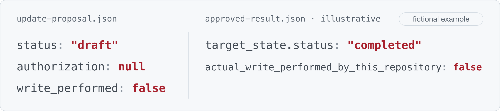
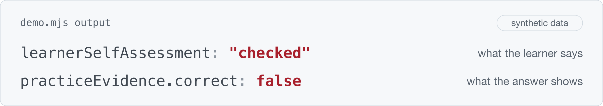

# byAsuka 

I’m exploring how agents build world models from partial observations, revise them with experience, and choose what to observe next.

## Selected work

### [Persistent Context](https://github.com/byAsuka/persistent-context)

A file-backed context workflow for AI assistants, keeping evidence, proposals, and verified updates distinct.

<a href="https://github.com/byAsuka/persistent-context">
  <picture>
    <source media="(prefers-color-scheme: dark)" srcset="assets/persistent-context-example-dark.png" />
    
  </picture>
</a>

Public protocol excerpt · synthetic example

### [Oasis · Learning State](https://github.com/byAsuka/oasis-learning-state-demo)

A runnable TypeScript excerpt that keeps learner self-assessment and practice evidence as separate records.

<a href="https://github.com/byAsuka/oasis-learning-state-demo">
  <picture>
    <source media="(prefers-color-scheme: dark)" srcset="assets/oasis-demo-output-dark.png" />
    
  </picture>
</a>

Component demo · full workspace in development

<!-- PROJECT AREA: add a project heading, description, real example and stage as public projects become ready. -->

## Image & sound

Photography, audiovisual production, piano, and physical interfaces.

[Notes & experiments](https://github.com/byAsuka/byAsuka/blob/main/project-notes.md)
